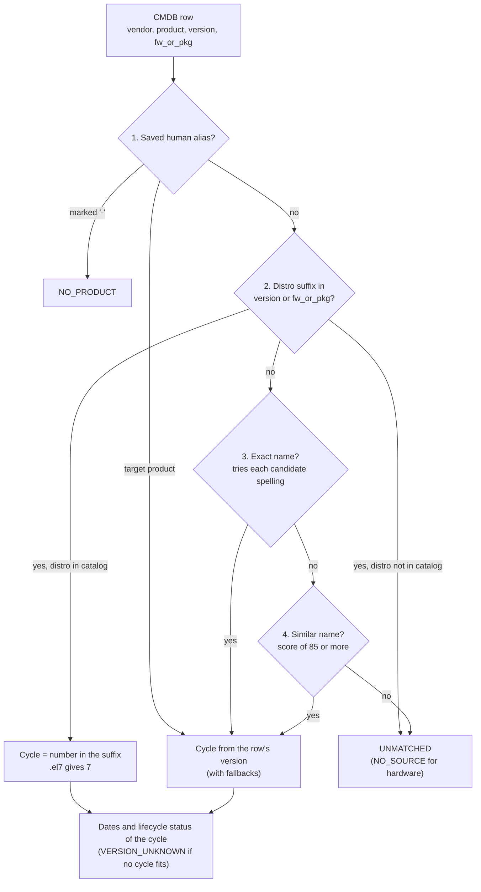

# CMDB Lifecycle Matcher

Match dirty CMDB rows (vendor, product, version) to canonical products, then attach end-of-life dates and known
vulnerabilities. Everything runs **offline** against a snapshot that is fetched once.

## Quick start
```bash
python3 -m venv .venv && .venv/bin/pip install -r requirements.txt
.venv/bin/streamlit run streamlit_app.py     # the committed data/master_catalog.csv is ready to use

# rebuild without network (committed raw files in snapshot/):
.venv/bin/python -m cmdb.ingest        # snapshot/ -> data/standard/*.csv
.venv/bin/python -m cmdb.catalog       # data/standard/*.csv -> data/master_catalog.csv

# refresh from the sources (needs internet; a source that fails keeps its previous data):
.venv/bin/python -m cmdb.ingest --fetch && .venv/bin/python -m cmdb.catalog
./run_all.sh                           # same, plus the public sample inventory and a matching run
```

## Pipeline
| Step | Code | Output |
|---|---|---|
| 1. Ingest (API + scraping) | `cmdb/ingest/<source>.py`, `python -m cmdb.ingest [--fetch] [--only ...]` | raw json in `snapshot/`, standardized `data/standard/<source>.csv` |
| 2. Master catalog | `cmdb/catalog.py`, `python -m cmdb.catalog` | `data/master_catalog.csv` (one row per product release cycle) |
| 3. Matching | `cmdb/matching/` (alias, package distro, exact on normalized names, fuzzy, cycle, lifecycle), `python -m cmdb.matching --cmdb in.csv --out out.csv` | matched rows; `cmdb/exposure.py` optionally adds KEV / EPSS / NVD columns |
| 4. UI | `streamlit_app.py`: loads a catalog and a CMDB file (`cmdb/inputs.py`), matches, shows coverage and a one-item lookup (`cmdb/view.py` holds the wording). Independent of steps 1-2 | |
| 5. Metrics | `cmdb/metrics.py`: catalog coverage per source, matching rates | |
| 6. Compare | `cmdb/compare.py`: match the same rows against several catalogs (your own component catalog CSV, single sources) | |

Column contracts for every step live in `cmdb/schema.py`. `tools/` holds test-data helpers (`make_synthetic_cmdb.py`,
`fetch_inventory.py`), the NVD index builder, and `score.py` (accuracy against the synthetic answer key). Tests: `pytest -q`.

## How one row is matched
[`match_one`](cmdb/matching/matcher.py#L168) answers two questions in turn: **which product** is this ([`find_product`](cmdb/matching/matcher.py#L123)), then **which release cycle** of it. The dates come from that cycle. The catalog is indexed once beforehand by [`build_index`](cmdb/matching/index.py#L55).



The first step that decides wins. A row with a distro suffix never goes on to name matching: a package has no end of life of its own.

| Step | Code |
|---|---|
| 1. Alias | [`find_alias`](cmdb/matching/matcher.py#L67), [`load_aliases`](cmdb/matching/matcher.py#L26) (the command line reads `aliases.csv`; the app does not pass aliases) |
| 2. Package distro | [`package_distro`](cmdb/matching/normalize.py#L119), [`DISTRO_RULES`](cmdb/matching/normalize.py#L53) |
| Candidate spellings (for step 3, and partly step 4) | [`name_candidates`](cmdb/matching/normalize.py#L129), [`VENDOR_RULES`](cmdb/matching/normalize.py#L29), [`ROLLUP_RULES`](cmdb/matching/normalize.py#L37) |
| 3. Exact | [`find_exact`](cmdb/matching/matcher.py#L72) |
| 4. Fuzzy | [`find_fuzzy`](cmdb/matching/matcher.py#L99), [`fuzzy_penalty`](cmdb/matching/matcher.py#L91) |
| Several products share a name | [`pick_product`](cmdb/matching/matcher.py#L49) |
| Release cycle | [`resolve_cycle`](cmdb/matching/lifecycle.py#L47), [`match_cycle`](cmdb/matching/lifecycle.py#L15) |
| Lifecycle status | [`lifecycle_status`](cmdb/matching/lifecycle.py#L68) |

A confidence of 90 or more is accepted automatically; below that the row is flagged for review. A row can also be flagged when the product is certain but the version is not.

### Worked example: a package
Row: `product=zip`, `version=3.0-11.el7`

1. No alias for `zip`.
2. `package_distro` reads `.el7` and returns `("Red Hat Enterprise Linux", "7")`.
3. `find_product` looks that name up in the index. Both endoflife.date and the Red Hat feed have it; `pick_product`, called without a vendor, takes endoflife.date (the Red Hat feed starts at RHEL 8). It returns `(product id, "distro", 95)`.
4. `match_one` calls `package_distro` again to get the `7`, and `match_cycle` finds cycle `7`. The package version `3.0-11` is not used.
5. Result: `matched_product=Red Hat Enterprise Linux`, `matched_cycle=7`, `eol_date=2024-06-30`.

**Why is `package_distro` called twice?** It does not choose between matching methods. It answers two things at once: which distro (needed to find the product) and which release (needed to find the cycle). `find_product` returns only `(product_id, method, confidence)`, so the release number is dropped there and `match_one` reads it again. The function only reads the row, so both calls give the same answer. The second call kept `find_product`'s return value unchanged; it is a shortcut in the code, not a matching step. `match_one` uses it only when the method is `distro`, so an aliased row goes through the normal version logic.

### More examples
Results with the committed catalog; lifecycle status and dates depend on the catalog and, for status, on the day of the run.

| Input (product, version) | How it matched | `matched_product` / `matched_cycle` | Confidence |
|---|---|---|---|
| `Python`, `3.11.4` | `exact`; `3.11.4` falls inside cycle `3.11` | Python / 3.11 | 98 |
| `Mozilla Firefox (hu)`, `115.0.2` (vendor Mozilla) | `exact+cleaned`: the `(hu)` suffix is removed | Firefox / 115 | 98 |
| `libssl3`, `3.0.2-0ubuntu1` (`fw_or_pkg=libssl3`) | `exact+rollup`: package rolled up to its upstream product. The Ubuntu suffix has no distro rule | OpenSSL / 3.0 | 92 |
| `Postgre SQL`, `15.2` | `fuzzy` | PostgreSQL / 15 | 95.2 |
| `Elasticsearh`, `8.1` | `fuzzy`; no `8.1` cycle matched, so the newest 8.x is shown and flagged `major-ambiguous` | Elasticsearch / 8.19 | 96 |
| `zip`, `3.0-11.el7` | `distro` | Red Hat Enterprise Linux / 7 | 95 |
| `Acme Billing Engine`, `2.1` | `none` | (empty): `UNMATCHED` | 0 |
| `gpg-pubkey`, `0f97f56-5a1b2c3d`, with alias `,gpg-pubkey,-` | `alias-none` | (empty): `NO_PRODUCT` | 100 |

## Using the app
`streamlit run streamlit_app.py`. The app only reads files: it never fetches, ingests or builds a catalog (that is
`python -m cmdb.ingest` then `python -m cmdb.catalog`, a separate step).

1. **Sidebar, your data**: upload your CMDB file (CSV with a `product` column; `version`, `vendor`, `fw_or_pkg`, `ci_type` improve the result). Without an upload the sample `cmdb_extract.csv` is used. `data/master_catalog.csv` is the default catalog when it exists; add your own catalog CSV(s) (`vendor`, `product`, `version`, optionally `eol`, `release_date`, `aliases`) to match against them too. A catalog you upload is enough on its own.
2. **Top of the page**: pick the catalog to look at (when there are several) and read four numbers: matched, with an end-of-life date, already end of life, to check.
3. **Results**: every CMDB row with what it matched, its lifecycle and end-of-life date. Search, filter by lifecycle, show only rows to check, download as CSV. Click a row for a plain-language explanation (why it matched, which release cycle, what the dates say), the product's other release cycles and the technical matching steps.
4. **Coverage**: one score table with a row per catalog (matched, end-of-life date found, already end of life, to check, not matched), the most frequent unmatched products, and what each catalog contains.
5. **Look up**: type vendor, product and version (a version inside the product name is detected; a package name is optional) and see the best match in every loaded catalog, why, and the release cycles that fit. Leave it empty to browse and search the catalog itself.

Code map for maintainers: `streamlit_app.py` is layout only (one function per tab); every label and sentence the user reads is in `cmdb/view.py`; reading files is `cmdb/inputs.py`; matching is `cmdb/matching/`. Tests: `tests/test_view.py` (wording, no Streamlit) and `tests/test_app_smoke.py` (the app end to end).

## Master catalog contents
Last refreshed 2026-11-24 (`snapshot/manifest.json` has the fetch time): 21,349 release cycles, 10,221 products.

| Source | Cycles | Notes |
|---|---|---|
| endoflife.date | 9,476 | OS, languages, databases, frameworks |
| eol.network | 5,135 | hardware; local use only, see below |
| IBM | 2,423 | hardware, bulk CSV |
| Red Hat | 1,580 | |
| Microsoft | 1,606 | scraped; paid ESU dates are folded into `end_extended` |
| Juniper | 617 | scraped |
| eosl.date | 11,111 | hardware (Apple, Brocade, Cisco, Dell EMC, HPE, IBM, Juniper, NetApp); scraped, one page per vendor |
| Apple | 481 | status only for vintage/obsolete models |
| Trellix | 1,195 | software versions and appliance models; read from the two CSV files behind trellix.com/support/end-of-life-products |
| Citrix | 36 | citrix.com product lifecycle matrix (CVAD, XenApp, NetScaler, FAS, App Layering, Secure Access, uberAgent) |
| NVIDIA | 25 | Jetson |
| VMware | 6 | public KB tables only |
| Cisco, manual | 0 | need credentials / a CSV in `manual/` |

eol.network's terms forbid republishing its data: keep `data/standard/eolnetwork.csv` and
`snapshot/vendor_lifecycle_eolnetwork.json` out of any public repository. Refreshing it only re-pulls vendors already
pulled (no new free-tier listing slot); new vendors need `--eol-vendors`.

## Known limits
- Cisco: the EoX v5 collector is tested only against a simulated API, never the live one. It needs a Cisco ID enabled for the Support APIs (Smart Net Total Care or Partner Support Service); a free Cisco.com account gets "HTTP 403 Developer Inactive". Run it with `CISCO_CLIENT_ID=.. CISCO_CLIENT_SECRET=.. python3 -m cmdb.ingest --fetch --only cisco`; a failed run leaves existing Cisco data untouched. Without access there is no scraper fallback yet. NetApp needs a manual CSV in `manual/`.
- eosl.date (`python -m cmdb.ingest --fetch --only eosldate`) is a third-party aggregate scraped from `https://eosl.date/vendor/<slug>/`; it covers Cisco, Dell, HPE and NetApp without credentials, but dates are not authoritative and the scraper depends on the page layout. Hardware without a vendor collector: Dell, HP/HPE, Sun/Oracle, Alcatel-Lucent Enterprise (Dell and HP answer scripted clients with HTTP 403; the others publish no bulk list). NVIDIA networking (Mellanox) EOL notices are PDFs and are not parsed.
- Apple publishes only "vintage" / "obsolete" model lists, no dates: obsolete = EOL, vintage stays UNKNOWN. iPhone, iPad and Watch come from endoflife.date, with dates.
- IBM hardware matches by machine type/model ("1747HC2") or by a marketing name derived from IBM's title ("Power S922"). Sibling models share a name (S922 = 9009-22A / 22G), so the first one is picked at confidence 93; their dates may differ. About a third of IBM rows have no end-of-support date.
- The VMware matrix is behind a login: only public KB tables are collected.
- Scrapers (Microsoft, Juniper) depend on page layouts and each site's terms.
- Accuracy figures come from a synthetic generator; the public inventory has no answer key.
